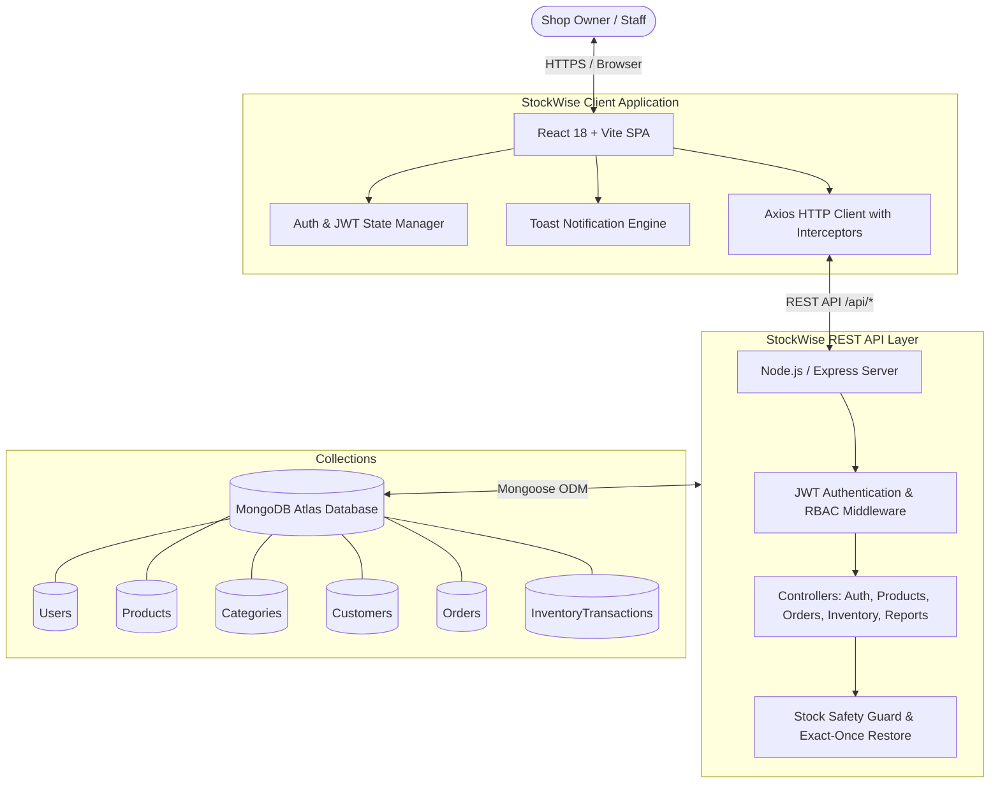
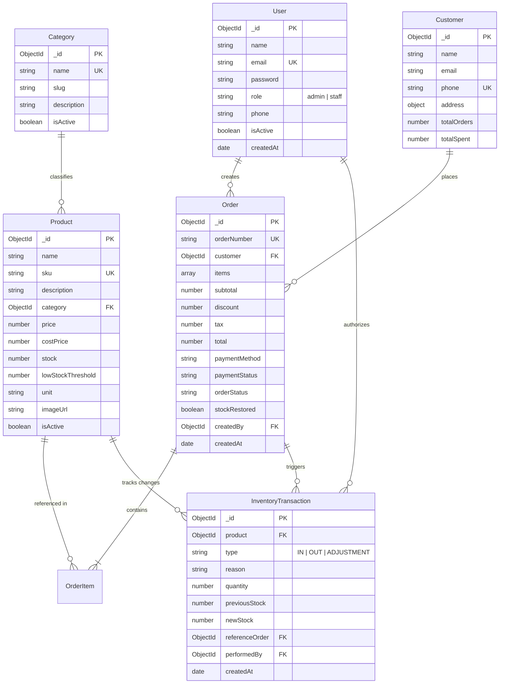

# StockWise – Smart Inventory & Order Management System

[](https://github.com)
[](https://vitejs.dev/)
[](https://tailwindcss.com/)
[](https://nodejs.org/)
[](https://www.mongodb.com/)
[](https://github.com)

**StockWise** is a modern, responsive, full-stack web application designed for small businesses, retail shops, warehouses, and shop owners to manage products, catalog categories, real-time stock levels, customer relations, and multi-item sales orders from a unified dashboard.

Designed specifically as an **end-to-end College Full Stack Development Project**, it demonstrates clean code separation, REST API design, Role-Based Access Control (RBAC), atomic inventory tracking, JWT security, and production cloud deployment readiness.

---

## Table of Contents
1. [Key Features](#key-features)
2. [Technology Stack](#technology-stack)
3. [Architecture Overview](#architecture-overview)
4. [User Roles & RBAC Matrix](#user-roles--rbac-matrix)
5. [Database Models & ER Diagram](#database-models--er-diagram)
6. [REST API Documentation](#rest-api-documentation)
7. [Getting Started (Step-by-Step Installation)](#getting-started-step-by-step-installation)
8. [Automated Verification Tests](#automated-verification-tests)
9. [Pre-Seeded Demo Accounts](#pre-seeded-demo-accounts)
10. [Deployment Guide (Vercel & Render)](#deployment-guide-vercel--render)
11. [College Viva & Interview Q&A](#college-viva--interview-qa)

---

## Key Features

- **Role-Based Access Control (RBAC):** Admin and Staff roles with distinct navigation, route protection, and API authorization guards.
- **Dynamic Executive Dashboard:** Real-time metrics aggregated directly from MongoDB (revenue, active products, total orders, low-stock warnings, sales trend area charts, and category pie distributions).
- **Product Catalog Management:** Full CRUD operations with auto-calculated low-stock thresholds, SKU uniqueness enforcement, image previews, category mapping, search, multi-factor filtering, and sorting.
- **Atomic Stock Tracking & Audit Trail:**
  - Automatic inventory deduction upon order placement.
  - Hard guards that prevent orders from exceeding available stock.
  - Manual stock adjustments (Restock, Damage/Loss, Audit Correction).
  - Immutable audit ledger (`InventoryTransaction`) capturing all stock changes with previous vs. new stock numbers, timestamps, and user attribution.
- **Reliable Order Cancellation (Exact-Once Stock Restoration):** When an order is marked `Cancelled`, reserved quantities are automatically refunded to inventory exactly once, preventing double-crediting.
- **Customer Relationship Tracking:** Complete customer directory tracking order counts and lifetime spend.
- **Interactive POS Order Terminal:** Cash register interface supporting multi-line items, live stock counters, discount percentage/fixed calculation, tax calculation, and payment methods (Cash, COD, Credit Card, Bank Transfer, UPI).
- **Reports & Analytics:** Period revenue velocity charts (Recharts), best-selling product leaderboard, category profit margin breakdown, and one-click CSV export.

---

## Technology Stack

### Frontend
- **Framework:** React.js 18 with Vite (Ultra-fast HMR and bundling)
- **Styling:** Tailwind CSS with custom navy palette and smooth transitions
- **Routing:** React Router DOM (Declarative client-side routing & Protected Routes)
- **Data Fetching:** Axios with interceptors for Bearer token injection and global 401 expiration handling
- **Visuals & Charts:** Recharts (Responsive Area, Bar, and Donut charts)
- **Icons:** Lucide React (feather-style clean SVG icons)

### Backend
- **Runtime & Framework:** Node.js (v18+) & Express.js
- **Database Modeling:** Mongoose ODM with schema validations, virtual fields, and compound indexes
- **Security:**
  - JSON Web Tokens (`jsonwebtoken`) with expiration
  - Password hashing with `bcryptjs` (salt factor 10)
  - Role-based middleware (`protect`, `authorize('admin')`)
  - CORS security & input sanitization
- **Database:** MongoDB Atlas (Production) / Automated in-memory fallback for local zero-friction setup

---

## Architecture Overview



---

## User Roles & RBAC Matrix

| Feature / Resource | Staff Role | Admin Role | Security Implementation |
| :--- | :---: | :---: | :--- |
| **Login & Profile View** | Allowed | Allowed | `protect` middleware |
| **View Catalog & Stock** | Allowed | Allowed | `protect` middleware |
| **Search & Filter Products** | Allowed | Allowed | `protect` middleware |
| **Add / Edit / Delete Products** | Forbidden | **Allowed** | `authorize('admin')` |
| **Manage Product Categories** | Forbidden | **Allowed** | `authorize('admin')` |
| **Create Customer Orders** | **Allowed** | **Allowed** | `protect` (Stock deducted automatically) |
| **View Orders & Invoices** | Allowed | Allowed | `protect` |
| **Cancel Order & Restore Stock**| Allowed | Allowed | Protected status update + exact-once check |
| **Manual Stock Adjustments** | Forbidden | **Allowed** | `authorize('admin')` |
| **View Audit History Logs** | Allowed | Allowed | `protect` |
| **View Sales Reports & Analytics** | Forbidden | **Allowed** | `authorize('admin')` |
| **Manage Staff Accounts** | Forbidden | **Allowed** | `authorize('admin')` |

> [!NOTE]
> Public user registration `/api/auth/register` is strictly locked to create **Staff** accounts only. New Admin accounts can only be provisioned by an existing Admin or via the secure seed script.

---

## Database Models & ER Diagram



---

## REST API Documentation

### Authentication (`/api/auth`)
| Method | Endpoint | Access Level | Description |
| :--- | :--- | :--- | :--- |
| `POST` | `/api/auth/register` | Public | Register a new user (Staff role enforced) |
| `POST` | `/api/auth/login` | Public | Authenticate user & return signed JWT token |
| `GET` | `/api/auth/me` | Authenticated | Retrieve current session user profile |
| `PUT` | `/api/auth/profile` | Authenticated | Update current user name, phone, or password |

### Products (`/api/products`)
| Method | Endpoint | Access Level | Description |
| :--- | :--- | :--- | :--- |
| `GET` | `/api/products` | Authenticated | List products with search, category filter, sorting & pagination |
| `GET` | `/api/products/low-stock` | Authenticated | Retrieve all products at or below safety stock threshold |
| `GET` | `/api/products/:id` | Authenticated | Retrieve a single product by ID |
| `POST` | `/api/products` | **Admin Only** | Create product and log initial inventory transaction |
| `PUT` | `/api/products/:id` | **Admin Only** | Update product details, pricing, or stock level |
| `DELETE`| `/api/products/:id` | **Admin Only** | Permanently remove product from catalog |

### Categories (`/api/categories`)
| Method | Endpoint | Access Level | Description |
| :--- | :--- | :--- | :--- |
| `GET` | `/api/categories` | Authenticated | List all categories with active product count |
| `POST` | `/api/categories` | **Admin Only** | Create a new product category |
| `PUT` | `/api/categories/:id` | **Admin Only** | Update category name / description |
| `DELETE`| `/api/categories/:id` | **Admin Only** | Delete category (blocked if products are assigned) |

### Orders & Checkout (`/api/orders`)
| Method | Endpoint | Access Level | Description |
| :--- | :--- | :--- | :--- |
| `GET` | `/api/orders` | Authenticated | List all customer orders with filtering |
| `POST` | `/api/orders` | Authenticated | Create multi-item order with atomic stock deduction |
| `GET` | `/api/orders/:id` | Authenticated | Retrieve printable order invoice details |
| `PUT` | `/api/orders/:id/status`| Authenticated | Update order status (Cancelling restores reserved stock) |

### Inventory & Audit (`/api/inventory`)
| Method | Endpoint | Access Level | Description |
| :--- | :--- | :--- | :--- |
| `GET` | `/api/inventory/summary` | Authenticated | Overview of total stock units, alerts, and valuation |
| `GET` | `/api/inventory/transactions` | Authenticated | Paginated movement history log |
| `POST` | `/api/inventory/adjust` | **Admin Only** | Manually adjust stock (Restock / Damage / Audit) |

### Executive Dashboard & Reports (`/api/dashboard` & `/api/reports`)
| Method | Endpoint | Access Level | Description |
| :--- | :--- | :--- | :--- |
| `GET` | `/api/dashboard/stats` | Authenticated | Live KPI cards (Revenue, orders, products, alerts) |
| `GET` | `/api/dashboard/sales` | Authenticated | Sales trend array (7/30 days) and category breakdown |
| `GET` | `/api/dashboard/recent-orders` | Authenticated | 5 most recent orders for dashboard table |
| `GET` | `/api/reports/daily` | **Admin Only** | Daily sales records with Average Order Value (AOV) |
| `GET` | `/api/reports/monthly` | **Admin Only** | Monthly aggregate revenue & order counts |
| `GET` | `/api/reports/top-products` | Authenticated | Leaderboard of top selling products by units & revenue |
| `GET` | `/api/reports/inventory-valuation` | **Admin Only** | Category-by-category retail vs cost profit margin report |

### Staff Management (`/api/users`)
| Method | Endpoint | Access Level | Description |
| :--- | :--- | :--- | :--- |
| `GET` | `/api/users` | **Admin Only** | List all registered staff & admin accounts |
| `POST` | `/api/users` | **Admin Only** | Admin provisions new staff account directly |
| `PUT` | `/api/users/:id` | **Admin Only** | Update user role, status (deactivate/activate), or phone |
| `DELETE`| `/api/users/:id` | **Admin Only** | Delete staff user (cannot delete own admin account) |

---

## Getting Started (Step-by-Step Installation)

### Prerequisites
- [Node.js](https://nodejs.org/) installed (v18.0.0 or higher recommended)
- [Git](https://git-scm.com/) installed
- A modern web browser (Chrome, Edge, Firefox, Brave)

---

### Step 1: Clone or Navigate to the Project

```bash
cd "c:\Users\Satyam\OneDrive\CODE AND NOTES\FS Project"
```

---

### Step 2: Install Backend & Frontend Dependencies

You can install all dependencies across both folders in one command from the project root:

```bash
npm run install:all
```

*Or manually in each directory:*
```bash
# In the backend directory
cd backend
npm install

# In the frontend directory
cd ../frontend
npm install
```

---

### Step 3: Configure Environment Variables

The project comes pre-configured with ready-to-use `.env` files for immediate local development.

#### Backend `.env` (`backend/.env`)
```env
PORT=5000
NODE_ENV=development
MONGODB_URI=mongodb://127.0.0.1:27017/stockwise
JWT_SECRET=stockwise_super_secret_jwt_key_2026_dev_mode_change_in_production
JWT_EXPIRE=7d
FRONTEND_URL=http://localhost:5173
```
> [!TIP]
> If you have a MongoDB Atlas connection string, simply paste it into `MONGODB_URI`. If you do not have MongoDB running locally, the backend **automatically starts an internal in-memory MongoDB database** so you can run the app without installing MongoDB!

#### Frontend `.env` (`frontend/.env`)
```env
VITE_API_URL=/api
```

---

### Step 4: Seed the Database with Realistic Demo Data

Run the database seed script to create initial admin and staff credentials, sample categories, catalog products (with low-stock and out-of-stock items), customer accounts, sample orders, and inventory movement logs:

```bash
cd backend
npm run seed
```

You should see:
```text
====================================================
 SEEDING COMPLETED SUCCESSFULLY!
====================================================
 Created:
   - 2 Users (Admin & Staff)
   - 5 Product Categories
   - 12 Products with rich data & low-stock test cases
   - 5 Customers with order records
   - 6 Orders across multiple statuses and dates
   - Inventory transaction history
====================================================
```

---

### Step 5: Start the Development Servers

Open two terminal tabs:

**Terminal 1 (Backend API):**
```bash
cd backend
npm run dev
```
*API runs at `http://localhost:5000`.*

**Terminal 2 (Frontend Client):**
```bash
cd frontend
npm run dev
```
*Frontend runs at `http://localhost:5173`.*

Open `http://localhost:5173` in your browser to experience StockWise!

---

## Automated Verification Tests

StockWise comes with an automated integration test suite that tests all critical backend flows end-to-end:
- Server health & status
- User registration and role enforcement
- Admin & staff credential authentication
- Protected routes and 401/403 RBAC checks
- Category and Product CRUD
- Stock guard (blocking orders exceeding stock)
- Order creation & atomic stock reduction
- Order cancellation and **exact-once** stock restoration
- Real-time MongoDB statistical aggregations

To run the automated tests:
```bash
cd backend
npm test
```

Expected result:
```text
============================================================
 Test Summary: 19 Passed, 0 Failed
============================================================
```

---

## Pre-Seeded Demo Accounts

For college project evaluation, practical exams, and viva demonstrations, the login screen includes **1-click autofill demo buttons**:

| Role | Email Address | Password | Permissions |
| :--- | :--- | :--- | :--- |
| **Administrator** | `admin@stockwise.com` | `Admin@123` | Complete control over products, staff, categories, reports, and stock adjustments |
| **Store Staff** | `staff@stockwise.com` | `Staff@123` | POS checkout, customer management, inventory view, order fulfillment |

---

## Deployment Guide (Vercel & Render)

### 1. Database: MongoDB Atlas
1. Create a free M0 Cluster on [MongoDB Atlas](https://www.mongodb.com/cloud/atlas).
2. Go to **Network Access** and add `0.0.0.0/0` (Allow access from anywhere).
3. Go to **Database Access** and create a user (e.g., `stockwise_user` with a strong password).
4. Click **Connect -> Drivers** and copy the connection string:
   `mongodb+srv://stockwise_user:<password>@cluster0.mongodb.net/stockwise?retryWrites=true&w=majority`

### 2. Backend: Deploy to Render
1. Push your repository to GitHub.
2. Sign in to [Render](https://render.com) and click **New Web Service**.
3. Select your repository.
4. Set the following fields:
   - **Root Directory:** `backend`
   - **Environment:** `Node`
   - **Build Command:** `npm install`
   - **Start Command:** `npm start`
5. Under **Environment Variables**, add:
   - `NODE_ENV`: `production`
   - `PORT`: `10000`
   - `MONGODB_URI`: `<your MongoDB Atlas URI from Step 1>`
   - `JWT_SECRET`: `<generate a random 64-character secret>`
   - `JWT_EXPIRE`: `7d`
   - `FRONTEND_URL`: `<your Vercel frontend URL, e.g. https://stockwise.vercel.app>`
6. Click **Deploy**. Note your live Render URL (e.g. `https://stockwise-api.onrender.com`).
7. Run the seed script on Render using the Render Shell tab: `node seed/seedData.js`.

### 3. Frontend: Deploy to Vercel
1. Sign in to [Vercel](https://vercel.com) and import your GitHub repository.
2. Set **Root Directory** to `frontend`.
3. Framework Preset: `Vite`.
4. Under **Environment Variables**, add:
   - `VITE_API_URL`: `https://stockwise-api.onrender.com/api`
5. Click **Deploy**. Vercel will build the frontend using `vercel.json` (SPA rewrites included) and provide your live production URL!

---

## College Viva & Interview Q&A

Here are key technical concepts frequently asked by examiners during project evaluations:

### 1. How does StockWise handle Role-Based Access Control (RBAC)?
> StockWise implements RBAC both on the backend and frontend. On the backend, JWT tokens contain the user ID. When an incoming request reaches `protect`, the user record is fetched and stored in `req.user`. The `authorize('admin')` middleware checks if `req.user.role` matches the required role; if not, it returns `403 Forbidden`. On the frontend, `ProtectedRoute` checks the `role` property in `AuthContext` and restricts staff from navigating to `/reports` or `/users`.

### 2. How is inventory concurrency and stock depletion handled?
> When an order is placed (`POST /api/orders`), the backend performs a pre-flight validation over all requested items before altering any record. If any product has `requestedQuantity > product.stock`, the transaction is aborted with `400 Bad Request`. When valid, stock is decremented and logged in `InventoryTransaction`.

### 3. How does the system guarantee exact-once stock restoration on cancellation?
> Each `Order` schema contains a boolean flag `stockRestored` (default: `false`). When `PUT /api/orders/:id/status` is called with `status = 'Cancelled'`, the server checks if `stockRestored === false`. If false, it increments product stock, logs an `ORDER_CANCELLED` transaction, and sets `stockRestored = true`. Any subsequent status update checks this flag to prevent duplicate restoration.

### 4. Why use JWT instead of traditional server-side sessions?
> JSON Web Tokens are stateless and self-contained. The server does not need to maintain an in-memory session store across distributed instances, making the application easily scalable and suitable for serverless and cloud container deployments like Render and Vercel.

### 5. How are dashboard statistics calculated?
> All metrics are calculated dynamically using MongoDB Aggregation Pipelines (`$match`, `$group`, `$sum`, `$lookup`) across live `Orders`, `Products`, and `Customers` collections, ensuring no statistics are hardcoded.

---

## Project Structure

```text
FS Project/
├── backend/
│   ├── config/
│   │   └── db.js                 # MongoDB connection with zero-friction in-memory fallback
│   ├── controllers/
│   │   ├── authController.js      # Register, Login, Me, Profile update
│   │   ├── categoryController.js  # Category CRUD & product count aggregation
│   │   ├── customerController.js  # Customer CRUD & purchase history
│   │   ├── dashboardController.js # Real-time MongoDB metrics & analytics
│   │   ├── inventoryController.js # Stock adjustment & transaction logs
│   │   ├── orderController.js     # POS order creation & exact-once cancellation
│   │   ├── productController.js   # Product catalog CRUD, search, filter, sort
│   │   ├── reportController.js    # Revenue velocity, top products & valuation
│   │   └── userController.js      # Admin staff management & account status
│   ├── middleware/
│   │   ├── authMiddleware.js      # JWT verify & RBAC authorization guards
│   │   └── errorMiddleware.js     # Centralized 404 & error handlers
│   ├── models/
│   │   ├── Category.js            # Category schema with auto-slug
│   │   ├── Customer.js            # Customer schema with lifetime stats
│   │   ├── InventoryTransaction.js# Stock ledger with previous vs new tracking
│   │   ├── Order.js               # Order schema with line items & stockRestored flag
│   │   ├── Product.js             # Product catalog schema with virtuals & indexes
│   │   └── User.js                # User schema with bcrypt hashing & role
│   ├── routes/
│   │   ├── authRoutes.js
│   │   ├── categoryRoutes.js
│   │   ├── customerRoutes.js
│   │   ├── dashboardRoutes.js
│   │   ├── inventoryRoutes.js
│   │   ├── orderRoutes.js
│   │   ├── productRoutes.js
│   │   ├── reportRoutes.js
│   │   └── userRoutes.js
│   ├── seed/
│   │   └── seedData.js            # Comprehensive sample database seeder
│   ├── tests/
│   │   └── api.test.js            # Automated integration test runner (19 assertions)
│   ├── utils/
│   │   └── generateToken.js       # Signed JWT generator utility
│   ├── .env.example
│   ├── package.json
│   └── server.js                  # Main Express application entrypoint
│
├── frontend/
│   ├── public/
│   │   └── favicon.svg            # StockWise logo icon
│   ├── src/
│   │   ├── components/
│   │   │   ├── charts/
│   │   │   │   ├── CategoryPieChart.jsx    # Donut chart for sales distribution
│   │   │   │   ├── SalesAreaChart.jsx      # Area chart for revenue trends
│   │   │   │   └── TopProductsBarChart.jsx # Horizontal ranking bar chart
│   │   │   ├── common/
│   │   │   │   ├── Badge.jsx               # Status & category pills
│   │   │   │   ├── ConfirmModal.jsx        # Action confirmation dialog
│   │   │   │   ├── EmptyState.jsx          # Friendly empty illustration state
│   │   │   │   ├── LoadingSpinner.jsx      # Animated SVG loading spinner
│   │   │   │   ├── Modal.jsx               # Accessible dialog container
│   │   │   │   ├── Pagination.jsx          # Page navigation component
│   │   │   │   └── StatCard.jsx            # Metric KPI card with trend badge
│   │   │   └── layout/
│   │   │       ├── MainLayout.jsx          # Sidebar + Topbar responsive wrapper
│   │   │       ├── Navbar.jsx              # Header with role pill & user badge
│   │   │       └── Sidebar.jsx             # Collapsible modern navy navigation
│   │   ├── context/
│   │   │   ├── AuthContext.jsx             # User credentials, JWT, login/logout
│   │   │   └── ToastContext.jsx            # Toast alerts notification manager
│   │   ├── hooks/
│   │   │   ├── useAuth.js                  # Auth hook
│   │   │   └── useToast.js                 # Toast hook
│   │   ├── pages/
│   │   │   ├── auth/
│   │   │   │   ├── Login.jsx               # Login with 1-click demo accounts
│   │   │   │   └── Register.jsx            # Staff account registration
│   │   │   ├── categories/
│   │   │   │   ├── CategoryList.jsx        # Categories cards with product count
│   │   │   │   └── CategoryModal.jsx       # Add/Edit category dialog
│   │   │   ├── customers/
│   │   │   │   ├── CustomerDetailModal.jsx # Profile & purchase order list
│   │   │   │   ├── CustomerList.jsx        # Customers directory table
│   │   │   │   └── CustomerModal.jsx       # Customer form
│   │   │   ├── dashboard/
│   │   │   │   └── Dashboard.jsx           # Main executive KPI dashboard
│   │   │   ├── inventory/
│   │   │   │   ├── InventoryList.jsx       # Stock levels, alerts & audit tabs
│   │   │   │   └── StockAdjustModal.jsx    # Manual restock/damage adjustment
│   │   │   ├── orders/
│   │   │   │   ├── CreateOrder.jsx         # Full POS checkout terminal
│   │   │   │   ├── OrderDetailModal.jsx    # Printable receipt modal
│   │   │   │   └── OrderList.jsx           # Orders table with status updates
│   │   │   ├── products/
│   │   │   │   ├── ProductList.jsx         # Search, filter, sort catalog table
│   │   │   │   └── ProductModal.jsx        # Add/Edit product form
│   │   │   ├── reports/
│   │   │   │   └── ReportsPage.jsx         # Sales graphs & CSV export
│   │   │   ├── users/
│   │   │   │   ├── UserList.jsx            # Admin staff management table
│   │   │   │   └── UserModal.jsx           # Add/Edit team member modal
│   │   │   └── NotFound.jsx                # 404 error page
│   │   ├── routes/
│   │   │   ├── AppRoutes.jsx               # React Router routes mapping
│   │   │   └── ProtectedRoute.jsx          # Route guard with RBAC checks
│   │   ├── services/
│   │   │   ├── api.js                      # Axios instance with interceptors
│   │   │   ├── authService.js
│   │   │   ├── categoryService.js
│   │   │   ├── customerService.js
│   │   │   ├── dashboardService.js
│   │   │   ├── inventoryService.js
│   │   │   ├── orderService.js
│   │   │   ├── productService.js
│   │   │   ├── reportService.js
│   │   │   └── userService.js
│   │   ├── App.jsx
│   │   ├── index.css
│   │   └── main.jsx
│   ├── .env.example
│   ├── index.html
│   ├── package.json
│   ├── tailwind.config.js
│   ├── vercel.json                         # Vercel SPA routing rewrites
│   └── vite.config.js                      # Vite proxy config
│
├── .gitignore
├── package.json                            # Root scripts for easy startup
├── render.yaml                             # Render infrastructure-as-code
└── README.md
```

---

## License

This project is licensed under the MIT License - free for educational and commercial use.
